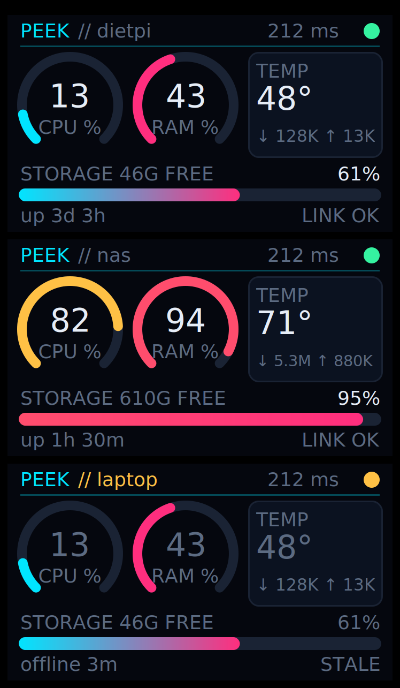
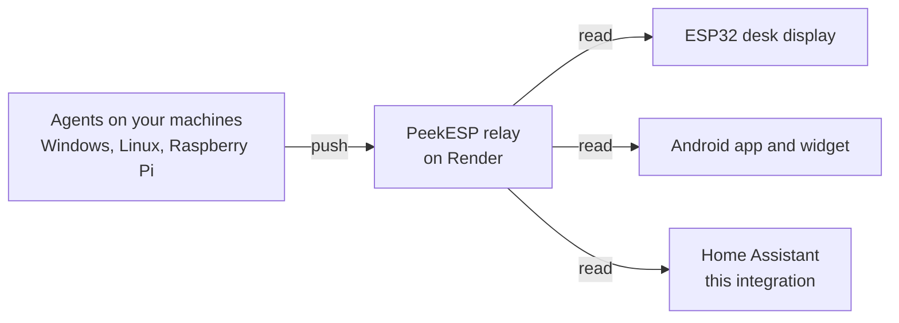

<p align="center">
  <a href="https://rhshourav.github.io/PeekESP/">
    
  </a>
</p>

<h1 align="center">PeekESP for Home Assistant</h1>

<p align="center">
  <a href="https://rhshourav.github.io/PeekESP/">Website</a> ·
  <a href="https://github.com/rhshourav/PeekESP">Main repository</a> ·
  <a href="https://github.com/rhshourav/PeekESP/wiki">Wiki</a> ·
  <a href="https://github.com/rhshourav/hass-peekesp/releases/latest">Latest release</a> ·
  <a href="https://github.com/rhshourav/hass-peekesp/issues">Issues</a>
</p>

The official Home Assistant integration for [**PeekESP**](https://github.com/rhshourav/PeekESP).
It turns your PeekESP machines into Home Assistant entities and adds a Lovelace
card that draws **the device's own screen** on a dashboard: same palette, same
layout, same gauges, same load colours, same 500 ms sweep.



It reads the same relay the ESP32 reads, which by default is the public PeekESP
relay at `https://peek-relay-b9a8.onrender.com`. Nothing is added to the device,
nothing needs to be opened on your network, and no firmware change is required.

## How it fits together



Everything dials out; nothing dials in, so there is no port forwarding and no
VPN. The firmware, the flashing tool, the agents, the relay and the Android app
all live in the main repository, [rhshourav/PeekESP](https://github.com/rhshourav/PeekESP).
Its [wiki](https://github.com/rhshourav/PeekESP/wiki) has the configuration
reference, the runbook and troubleshooting, and the
[project website](https://rhshourav.github.io/PeekESP/) tells the story and has
install steps for every platform.

## Install

**With HACS** (and the Marketplace in Home Assistant 2026.11 and later):

1. Open HACS, menu, **Custom repositories**, add
   `https://github.com/rhshourav/hass-peekesp` as type **Integration**.
   (Once it is in the default catalog you can just search for *PeekESP*.)
2. Download **PeekESP** and restart Home Assistant.

[](https://my.home-assistant.io/redirect/hacs_repository/?owner=rhshourav&repository=hass-peekesp&category=integration)

**Manually:** copy `custom_components/peekesp` into your config folder and
restart.

Then:

3. **Settings → Devices & services → Add integration → PeekESP**.
   - *Pairing code*: the code your agent was set up with (the one the device
     showed on first boot). Dashes optional.
   - *Relay URL*: **leave it as it is.** The default is
     `https://peek-relay-b9a8.onrender.com`. Change it only if you run your own
     relay, and then it must be the same relay your agents and display use. Use
     an `https://` address: the read token travels in a request header.
   - *Token*: only for a named or private stream on a relay you host. Not
     needed on the default relay.
4. Add the card. It is loaded automatically; pick **PeekESP screen** in the
   card picker, or in YAML:

```yaml
type: custom:peekesp-card
entity: sensor.dietpi_screen
name: Pi            # optional, replaces the host name after "//"
```

One card per machine. For a wall of them:

```yaml
type: grid
columns: 2
square: false
cards:
  - { type: custom:peekesp-card, entity: sensor.dietpi_screen }
  - { type: custom:peekesp-card, entity: sensor.nas_screen }
```

## What you get

Per machine (a device named after the host): CPU, RAM, storage used / free /
total, temperature, download, upload, uptime, battery and charging (only on
machines that report one), a *Reporting* connectivity sensor, and the
**Screen** sensor the card reads. On the relay device: latency and the newest
published firmware version. Machines appear on their own when they first
report.

## How the card tells you what is wrong

It uses the device's three link states, and the readings dim when they are old.

| Shows | Meaning |
|---|---|
| `LINK OK` (green) | the relay heard from the machine within the offline window |
| `STALE` (amber), `offline 3m` | relay reachable, machine stopped pushing |
| `NO LINK` (red) | Home Assistant cannot reach the relay; last values stay, dimmed |

`NO LINK` that appears once and clears by itself is usually the relay waking
up, not your network. See the next section.

## About the default relay

The default relay, `https://peek-relay-b9a8.onrender.com`, runs on Render's free
instance type in Singapore and is shared by everyone who does not set their own.
Free instances trade reliability for cost, and two things follow:

| What happens | What you see | How it clears |
|---|---|---|
| The relay gets no traffic for 15 minutes (every agent off and Home Assistant off) | It sleeps. The next poll can take a while to be answered, and the card may read `NO LINK` | By itself, once the relay is awake |
| Render restarts or redeploys the relay (it can do so at any time) | The relay forgets its readings, because a free instance has no disk, so machines can briefly show as not reporting | Within a few seconds, as each machine pushes again |

While anything pushes or polls every few minutes the relay stays awake, and a
running Home Assistant polling every 10 s is enough on its own.

**What it stores.** Only the latest reading of each machine, in memory. There is
no history on the relay; Home Assistant's recorder keeps yours.

**What that means for privacy.** The pairing code is the credential: anyone who
has it can read that stream, and the host names and readings pass through a
relay run by the PeekESP project. If that is not acceptable for your machines,
run your own.

**Running your own.** `render.yaml` at the root of the
[main repository](https://github.com/rhshourav/PeekESP) deploys the relay to
Render in a few clicks, and [`relay/`](https://github.com/rhshourav/PeekESP/tree/main/relay)
has the guide. Then set *Relay URL* here to your address, and set the same
address in your agents, display and Android app. If they disagree, each sees an
empty stream and nothing appears.

## Options

*Poll interval* (default 10 s, minimum 5) and *Mark offline after* (default
30 s). The device polls the same relay every 5 s, and the default relay is one
small free instance shared by everyone using it, so every Home Assistant poll is
one more request to it. Leave the interval alone unless you have a reason.

The `Screen` sensor changes on every poll. If you care about database size,
exclude it from the recorder:

```yaml
recorder:
  exclude:
    entity_globs:
      - sensor.*_screen
```

## If something looks wrong

| Symptom | Likely cause |
|---|---|
| No entities appear after setup | The relay cannot tell a mistyped code from a new code nothing has pushed to yet, so check the code against the one on the device. Also check that *Relay URL* matches the relay your agents push to. |
| `NO LINK` for the first poll or two, then fine | The relay was asleep or had just restarted. Nothing to fix. |
| `STALE` and `offline 3m` | The relay is fine and that machine stopped pushing. Look at the agent or the device. |

## Security notes

- The pairing code is the credential. Home Assistant stores it with the
  integration's configuration in your config folder, unencrypted like every
  config entry, so treat backups accordingly and do not paste the code into
  issues or screenshots.
- Use an `https://` relay address only. The read token is sent in a request
  header.
- The code lets someone read your readings. It does not let them reach your
  network: nothing here opens a port.

## Differences from the glass

- The throughput line shrinks (never below 9 px) instead of clipping, which
  is what the device does when "↓ 5.3M ↑ 880K" is wider than its panel.
- The ping figure is Home Assistant's round trip to the relay, not the
  device's.
- Montserrat is used if installed, otherwise the system sans-serif.

## Tests

```
python3 tests/test_core.py        # pairing vector, parsing, client vs a fake relay
node tests/test_card.js           # needs: npm i jsdom
```

## What has been verified

**In use:** the integration has been run in a real Home Assistant and works. It
follows current APIs (2025.1+).

**Automated, in `tests/`:** the pairing derivation against the vector pinned in
`PeekESP.ino`; payload parsing including the firmware's sentinels; the relay
client against a fake server; the card's logic across online / stale /
unavailable / missing; the card's rendering, rasterised outside a browser.

## Links

- Website: [rhshourav.github.io/PeekESP](https://rhshourav.github.io/PeekESP/)
- Main project: [rhshourav/PeekESP](https://github.com/rhshourav/PeekESP) (firmware, agents, relay, Android app)
- Wiki: [github.com/rhshourav/PeekESP/wiki](https://github.com/rhshourav/PeekESP/wiki)
- Issues with this integration or the card: [rhshourav/hass-peekesp](https://github.com/rhshourav/hass-peekesp/issues)
